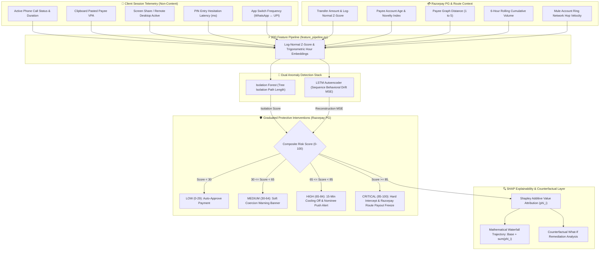

# SentinelUPI — Technical Architecture & System Data Flow

**Track**: Razorpay AI Buildathon 2026 — Track 02: AI Risk Manager  
**Project**: SentinelUPI — Scam-Induced Transfer Behavioral Detector

---

## 1. High-Level Data Flow Diagram (Mermaid)



---

## 2. Razorpay Guardrail Architecture & Payout Defense

```
+-------------------------------------------------------------------------------+
|                    Client Session & Transaction Telemetry                     |
|  [ Active Call ]  [ Screen Share ]  [ Pasted VPA ]  [ Hesitation Latency ]    |
+--------------------------------──────┬----------------------------------------+
                                       │
                                       ▼
+-------------------------------------------------------------------------------+
|               Feature Engineering Pipeline (feature_pipeline.py)              |
|  Normalizes 20 non-content behavioral telemetry features into [0, 1]          |
+--------------------------------──────┬----------------------------------------+
                                       │
          ┌────────────────────────────┴────────────────────────────┐
          ▼                                                         ▼
+-------------------------------------+   +-------------------------------------+
|      Isolation Forest Baseline      |   |       LSTM Autoencoder Model        |
|    (Tree isolation path length)     |   |    (Sequence reconstruction MSE)    |
+----------------─┬───────────────────+   +----------------─┬───────────────────+
                  └─────────────────────┬───────────────────┘
                                        ▼
+-------------------------------------------------------------------------------+
|            SHAP Explainability & What-If Layer (shap_explainability.py)       |
|  • Mathematical Waterfall: Base Risk (10.0) + sum(phi_i) -> Final Score       |
|  • Counterfactual Remediation: "If call ends & payee verified, risk -> 18"    |
+--------------------------------──────┬----------------------------------------+
                                       │
                                       ▼
+-------------------------------------------------------------------------------+
|                     Razorpay AI Risk Manager Interventions                    |
|  • LOW (0-29): Auto-Approve                                                   |
|  • MEDIUM (30-64): Soft Phone-Call Warning Banner                             |
|  • HIGH (65-84): 15-Min Cooling Off & Emergency Nominee Push Alert            |
|  • CRITICAL (85-100): Hard Intercept & Razorpay Route Settlement Freeze       |
+-------------------------------------------------------------------------------+
```

---

## 3. Defense-Only Framing

SentinelUPI operates exclusively as an inline guardrail within Razorpay AI Risk Manager to detect, intercept, and mitigate panic coercion fraud. No evasion methodologies or exploitation techniques are demonstrated.
